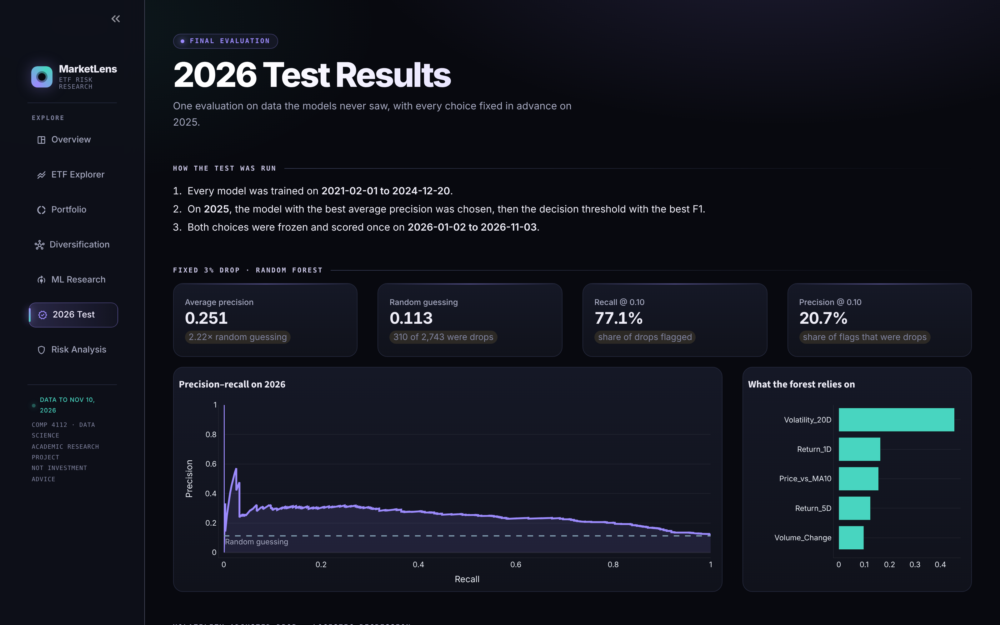
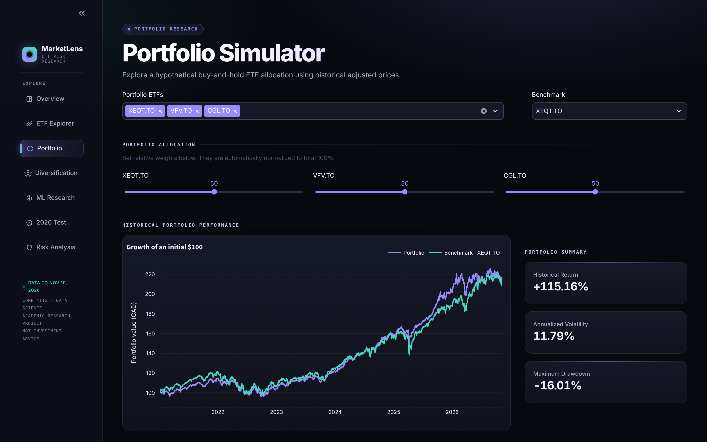

# MarketLens

[](https://github.com/ChachraArnav/MarketLens/actions/workflows/ci.yml)

Historical analytics and downside-risk research for 13 Canadian-listed ETFs, with an interactive Streamlit dashboard.

MarketLens asks one question: **using only what is known at today's close, can a model rank the days most likely to be followed by a sharp five-day drop better than chance?** It answers it with a chronological train / validation / test design, a pre-registered final test on data the models never saw, and results reported against a random-guessing baseline.


## Results

Every number below comes from `python -m marketlens all` and is checked by CI.

**2026 untouched test.** The model and threshold were chosen on 2025, frozen, then scored once on January 2 to November 3, 2026 (2,743 ETF-days).

| Risk definition | Chosen on 2025 | Average precision | Random guessing | Lift | Recall | Precision |
| --- | --- | --- | --- | --- | --- | --- |
| Fixed: next 5 days fall at least 3% | Random Forest, threshold 0.10 | **0.251** | 0.113 | **2.2×** | 77.1% | 20.7% |
| Volatility-adjusted: fall beyond 1.5σ | Logistic Regression, threshold 0.50 | 0.067 | 0.058 | 1.15× | 40.6% | 5.4% |

**What that means.** For the fixed 3% definition, the Random Forest ranks risky days about twice as well as chance, both on 2025 (0.150 vs 0.069) and on unseen 2026. At its threshold it flags roughly three quarters of the drops, and about one in five of its alerts is correct.

**But most of that is volatility.** A model-free check, added *after* the 2026 test had been seen, ranks each day by its 20-day volatility and nothing else:

| Average precision | 2025 validation | 2026 test |
| --- | --- | --- |
| Random guessing | 0.069 | 0.113 |
| Volatility rule (no model) | 0.124 | **0.265** |
| Random Forest | **0.150** | 0.251 |

For the fixed 3% label the volatility rule is about as good as the forest: a little worse on 2025, a little better on 2026. The forest's own feature importances agree, with `Volatility_20D` far ahead. In other words, a fixed 3% drop is mostly explained by how volatile an ETF is at the time (gold miners and tech fall 3% far more often than bonds, and every ETF more often in turbulent spells), not by a distinct short-term warning pattern. When the bar scales with each ETF's own volatility, the drop becomes close to unpredictable from these features: the best model reaches 0.067 against 0.058 for chance on 2026, and the volatility rule falls below chance. That combined finding, not the 2.2× headline, is the main result.

**2025 validation, all models** (average precision; random guessing = event rate):

| Risk definition | Baseline | Logistic Regression | Random Forest | Neural Network |
| --- | --- | --- | --- | --- |
| Fixed 3% | 0.069 | 0.125 | **0.150** | 0.146 |
| Volatility-adjusted | 0.056 | **0.067** | 0.065 | 0.064 |

Accuracy is deliberately not the headline. Because fewer than 1 in 10 days are drops, a model that never predicts a drop scores 93% accuracy and is useless.



## Method

| | |
| --- | --- |
| **Data** | Daily adjusted prices from Yahoo Finance, January 2021 to November 2026: VFV, XEQT, ZNQ, XIC, XEF, XEC, XFN, XEG, XBB, XGD, XRE, XIT and CGL (all `.TO`). Validated for non-positive prices, duplicates and missing values. |
| **Features** (known at day *t*) | 1-day return, 5-day return, 20-day volatility, price vs 10-day average, 1-day volume change |
| **Labels** (next 5 trading days) | *Fixed*: return ≤ −3%. *Adjusted*: return ≤ −1.5 × 20-day volatility × √5 |
| **Train** | 2021 to 2024, with the last 5 trading days purged because their labels look into 2025 |
| **Validation** | 2025: compare models, choose a model by average precision, then a threshold by F1 |
| **Test** | 2026: scored once with the frozen choices |
| **Models** | Majority-class baseline, logistic regression (balanced), random forest, small neural network (16-8). Scaling lives inside a scikit-learn pipeline, so it's fit on training data only. |

**Is the data trustworthy?** Yahoo Finance is free and unofficial, so its prices were cross-checked against [TMX Money](https://money.tmx.com), the Toronto Stock Exchange's market data site (`python -m marketlens crosscheck`, files in `data/external/`). TMX caps downloads at 90 days, so three XEQT windows were sampled: early 2022, early 2025 and August to November 2026.

| Check | Result |
| --- | --- |
| Trading days compared | 188 |
| Dates in one source but not the other | 0 |
| Closing prices, once Yahoo's dividend adjustment is undone | all within 0.5¢ (consistent with rounding of half-cent prices) |
| Daily volume | 187 of 188 days within Yahoo's rounding to the nearest 100 shares; the one exception differs by 1.1% (February 1, 2022) |
| Dividend adjustments | 3 of 3 fall on BlackRock's ex-distribution dates and imply exactly the announced cash amounts ($0.084, $0.090, $0.102) |

Before every build, `data.validate` also rejects non-positive prices, duplicate ticker-dates and missing values. Limitation: the cross-check covers one ETF and three windows, not every price.

**Leakage checks are tests, not promises.** `tests/test_features.py` shocks every price after a cutoff date and asserts that no feature on or before that date changes. `tests/test_splits.py` asserts that the periods are ordered, don't overlap and that training is purged.

**Limitations.** This covers one test period in one market regime and 13 related ETFs, whose returns are correlated, so the effective sample is smaller than 2,743. Overlapping five-day labels make neighbouring days dependent. The results are historical, exclude costs and are not a trading strategy or investment advice.

## The dashboard

| Page | What it shows |
| --- | --- |
| Overview | Price history, total return, annualized volatility, max drawdown and downside-event frequency per ETF |
| Data Quality | Collection summary, automated checks, and the TMX cross-check with dividend reconciliation |
| ETF Explorer | Growth of $100 for up to six ETFs over their shared history |
| Portfolio | Buy-and-hold simulator with weights and a benchmark |
| Diversification | Daily-return correlation matrix and pair explorer |
| ML Research | 2025 validation: pick a risk definition, model and threshold; see the confusion matrix and precision-recall curve |
| 2026 Test | The final evaluation above, precision-recall against random guessing and the volatility rule, feature importance |
| Risk Analysis | Downside-event frequency by ETF under both definitions |



## Run it

Requires Python 3.11 or newer.

```bash
python -m venv .venv
.venv\Scripts\activate            # Windows PowerShell
# source .venv/bin/activate       # macOS / Linux
pip install -r requirements.txt
streamlit run app.py
```

The processed data and results are committed, so the dashboard works immediately.

### Rebuild the research

```bash
python -m marketlens all          # validate prices, build features and labels, evaluate, cross-check
python -m marketlens download     # optional: fetch fresh prices from Yahoo Finance first
```

Downloading fresh prices changes the 2026 test period, so the numbers above will move. Commit the regenerated `results/` with any README changes.

### Tests and lint

```bash
pip install -r requirements-dev.txt
pytest
ruff check .
```

CI runs both on every push. It also rebuilds the research from the saved prices and fails if the committed results don't reproduce.

## Project structure

```
app.py                     Streamlit dashboard
marketlens/
  config.py                Tickers, dates, features, label definitions, split boundaries
  data.py                  Download, combine and validate prices
  features.py              Features (past only) and labels (next 5 days)
  splits.py                Chronological split with purge gap
  models.py                Model definitions
  evaluate.py              Validation comparison, threshold sweep, single 2026 test
  crosscheck.py            Yahoo vs TMX Money price cross-check
  analytics.py             Returns, volatility, drawdown, buy-and-hold portfolios
  __main__.py              Command line: python -m marketlens ...
tests/                     pytest suite
data/raw/                  One CSV per ETF from Yahoo Finance
data/processed/            Combined prices and the modelling dataset
data/external/             TMX Money downloads and BlackRock distribution records
results/                   Model comparison, threshold sweep, predictions, 2026 test
```

## Deploying (Streamlit Community Cloud, free)

1. Push this repository to GitHub, including `data/` and `results/`.
2. Go to https://share.streamlit.io, sign in with GitHub and click **Create app**.
3. Pick `ChachraArnav/MarketLens`, branch `main`, main file `app.py`.
4. Under **Advanced settings**, choose Python 3.12. Then deploy.

Free apps go to sleep after a few days without visitors and take about 30 seconds to wake.

---

Built by Arnav Chachra as a data science research project. Historical analysis only; not investment advice.
